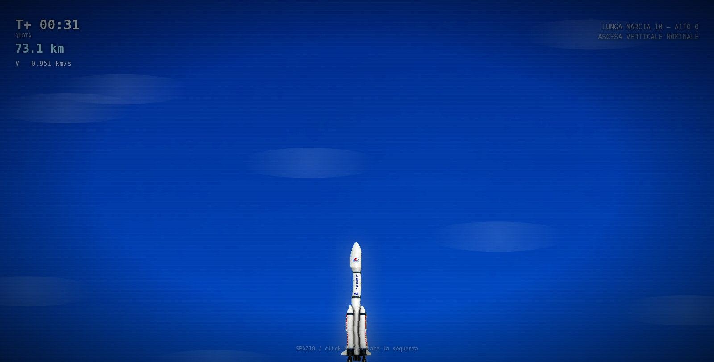
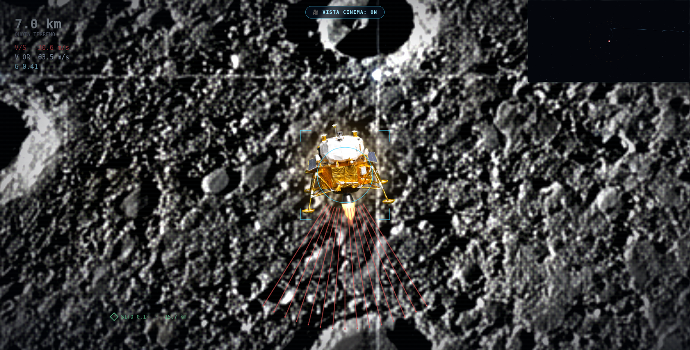
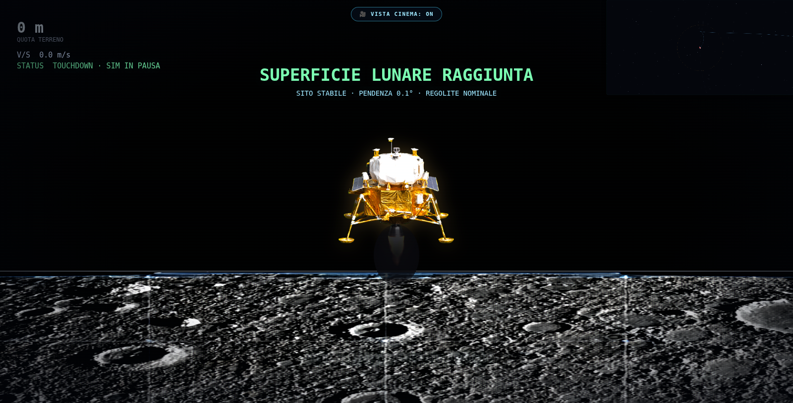
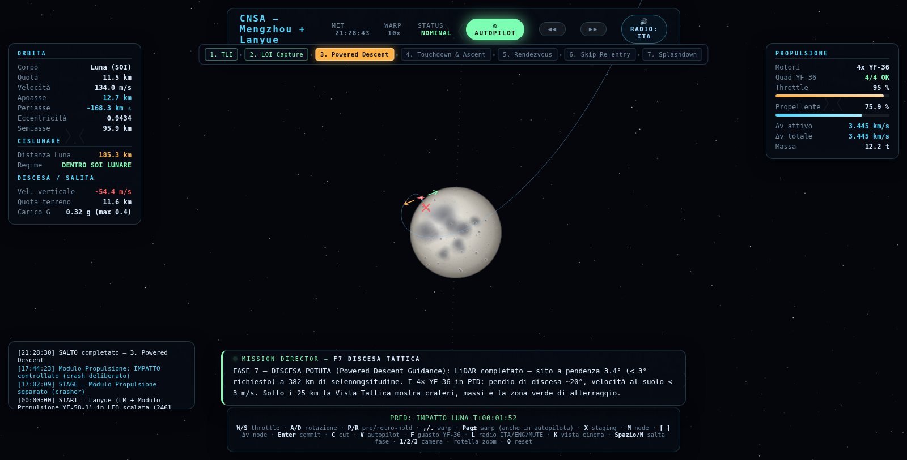

# CISLUNAR 2030 — Viaggio sulla Luna

**🎮 Giocalo subito nel browser (senza installare nulla):**
<https://amxstudiohub.github.io/viaggio-sulla-luna/>

Il simulatore è statico al 100%: nessun server, nessun account, nessuna dipendenza.

Simulatore 2D di viaggio cislunare in **HTML5 Canvas + moduli ES6 vanilla, zero dipendenze**:
fisica CR3BP (restrizione circolare dei tre corpi) scalata 1:10, autopilota a fasi,
discesa e ascesa lunare cinematiche, rientro a rimbalzo atmosferico, radio CapCom con
**voce neurale pre-registrata** che funziona completamente offline.

Due missioni complete:

| Missione | Veicolo | Note |
|---|---|---|
| **CNSA** | Mengzhou + Lanyue (YF-58-1 / 4× YF-36) | TLI → LOI → PDIT → allunaggio → ascesa → rendezvous → TEI → skip re-entry → ammaraggio |
| **Starship HLS** | HLS a 4 Raptor | profilo di discesa più spinto, atterraggio ~2,1 g |






## Avvio

La via normale è **il sito**: basta un browser moderno (Edge, Chrome, Firefox), niente da installare.

In alternativa, dal terminale nella cartella del progetto:

```bash
python3 -m http.server 8137      # oppure: node server_node.cjs
# poi apri http://localhost:8137
```

Serve un server HTTP perché i moduli ES6 da `file://` vengono bloccati dal browser. Per Windows esiste un pacchetto pronto (doppio clic su `Avvio_Windows.bat`), nella **Release** più recente: online non serve.

Nessuna libreria da installare: il progetto non ha dipendenze runtime.

## Comandi

```
1 / 2      missione CNSA o SpaceX        V   autopilota on/off
Spazio/N   salta alla fase dopo          1/2/3  camera Terra / Luna / nave
Pag Su/Giù warp manuale                  K   vista cinema
W/S throttle · A/D rotazione             L   radio ITA / ENG / MUTE
, / .  warp · M node · [ ] delta-v node  0   reset missione
Enter commit burn · C cut · X staging    F   guasto motore (test)
```

Sulla superficie lunare: **SPAZIO** = decollo (F8). La timeline in alto è cliccabile.

## La radio

Il Controllo Missione usa **206 clip neurali pre-registrate** (`assets/audio/comms/`, IT + EN,
28 minuti di parlato, 4,9 MB) riprodotte da un bus radio simulato (passa-banda, lieve
saturazione, flutter, Quindar tones 2525/2475 Hz, fruscio e ducking del rombo motori).
Nessuna sintesi vocale del browser, nessuna connessione internet.

```bash
node tools/tts_bake.mjs        # rigenera le clip dal copione (serve internet, solo in dev)
node tools/comms_harvest.mjs   # estrae il corpus reale dei messaggi di gioco
node tools/comms_check.mjs     # verifica che ogni messaggio abbia la sua clip
```

Il copione sta in `data/comms_lines.js`: lo schermo mostra i numeri esatti del Director,
la radio legge la frase curata con i numeri arrotondati a una griglia chiusa.

## Test

```bash
node tests/smoke.mjs           # 11 test di fisica/planetaria
node tests/integration.mjs     # missione CNSA completa headless
node tests/autopilot.test.mjs  # demo autopilota
node tests/phase2.test.mjs     # 58 messaggi director, fino a splashdown
node tests/spacex.test.mjs     # HLS: atterraggio ~2,1 g max
node tests/comms.test.mjs      # copione radio, numeri a parole, manifest clip
```

Struttura: `core/physics.js` (CR3BP, staging, modello di rientro con atmosfera reale) ·
`systems/autopilot.js` (fasi F1→F13: crociera, rientro a skip, ammaraggio) ·
`systems/descent.js` (GNC PID e glide-slope) · `systems/planner.js` (TimeWarp, maneuver node) ·
`systems/audio_comms.js` (radio e audio procedurale) · `ui/cockpit.js` (tactical + cinematiche) ·
`data/` (specifiche veicoli, copione radio, manifest).

La scena terminale è una cinematica dedicata: interfaccia atmosferica a 100 km a 11 km/s,
un rimbalzo vero sull'atmosfera (skip), blackout di plasma, picco di decelerazione,
paracadute di frenazione e quattro calotte principali fino all'ammaraggio nel Mar Cinese
Meridionale, con nave ed elicottero di recupero.

## Documentazione

`MANUALE_CISLUNAR_2030.docx` è il manuale completo di missione e di fisica.
`LEGGIMI_WINDOWS.txt` le istruzioni di avvio su Windows.

---

© AMX Studio — tutti i diritti riservati.
